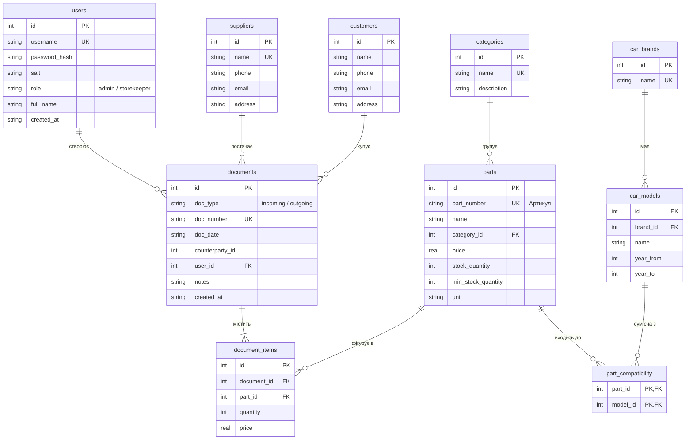

# Автоматизована система обліку запчастин легкових автомобілів

Курсовий проект: десктопний додаток для автоматизації складського обліку автозапчастин у магазині / автосервісі.

[](https://github.com/mdnghti/parts_accounting/actions/workflows/build.yml)
[](LICENSE)

---

## 🛠️ Стек технологій

- **Мова програмування**: Python 3.11+
- **Графічний інтерфейс**: PySide6 (офіційні Qt-біндінги)
- **База даних**: SQLite 3 (`sqlite3`, чистий SQL з параметризацією `?`, без ORM, 3-тя нормальна форма)
- **Генерація звітів**: openpyxl (Microsoft Excel `.xlsx`), reportlab (PDF-документи з кирилицею)
- **Тестування**: pytest (26 автоматизованих тестів)
- **Збірка**: PyInstaller (Linux виконуваний файл та Windows `.exe` через GitHub Actions)

---

## 🚀 Встановлення та запуск із вихідного коду

### 1. Клонування репозиторію

```bash
git clone https://github.com/mdnghti/parts_accounting.git
cd parts_accounting
```

### 2. Створення віртуального оточення та встановлення залежностей

```bash
python3 -m venv .venv

# Linux / macOS:
source .venv/bin/activate

# Windows (Command Prompt або PowerShell):
# .venv\Scripts\activate

pip install --upgrade pip
pip install -r requirements.txt
```

### 3. Запуск додатку

```bash
python main.py
```

> **Примітка**: При першому запуску додаток автоматично створить файл бази даних `parts_accounting.db` поруч із скриптом/виконуваним файлом та наповнить його первинними тестовими даними (користувачі, марки авто, категорії, запчастини, постачальники та покупці).

### 4. Запуск автоматизованих тестів

```bash
# Для запуску тестів у headless/offscreen режимі:
QT_QPA_PLATFORM=offscreen pytest -v
```

---

## 📦 Збірка виконуваних файлів (.exe та Linux binary)

### Локальна збірка під Linux

Для перевірки та отримання автономного Linux-бінарника виконайте скрипт:

```bash
chmod +x build.sh
./build.sh
```

Готовий дистрибутив буде створено в каталозі `dist/PartsAccounting/`. Виконуваний файл: `dist/PartsAccounting/PartsAccounting`.

---

### Автоматична збірка Windows `.exe` через GitHub Actions

Проект налаштований для автоматичної крос-платформної компіляції Windows-версії через хмарний раннер GitHub Actions (`windows-latest`):

1. **Запуск збірки**:
   - Перейдіть у вкладку **Actions** вашого GitHub-репозиторію: `https://github.com/mdnghti/parts_accounting/actions`.
   - Зліва виберіть workflow **Build Windows Application**.
   - Натисніть кнопку **Run workflow** (або просто зробіть `git push` у гілку `master`).
2. **Завантаження готового `.exe`**:
   - Після завершення збірки (зелена позначка ✔️) натисніть на відповідний запуск workflow.
   - Прокрутіть сторінку вниз до розділу **Artifacts**.
   - Натисніть на посилання **PartsAccounting-Windows-x64** та завантажте ZIP-архів.
   - Розпакуйте архів на комп'ютері з Windows.
   - Запустіть файл `PartsAccounting.exe`.

> **Важливо щодо файлу БД**: файл бази даних `parts_accounting.db` **не запаковується всередину виконуваного файлу**, а автоматично створюється поруч із `PartsAccounting.exe` при першому запуску. Це гарантує збереження всіх введених даних між запусками програми.

---

## 👥 Облікові записи за замовчуванням

| Логін | Пароль | Роль | Призначення |
| :--- | :--- | :--- | :--- |
| `admin` | `admin123` | **Адміністратор** | Повний доступ (склад, прихід/розхід, додавання/редагування/видалення всіх довідників, звіти) |
| `keeper` | `keeper123` | **Комірник** | Доступ до складу, проведення прибуткових та видаткових накладних, перегляд довідників (без права видалення) |

*Паролі зберігаються в базі виключно у вигляді криптографічних хешів PBKDF2-HMAC-SHA256 (100 000 ітерацій з унікальною сіллю).*

---

## 📖 Інструкція користувача

### 1. Авторизація
При старті з'являється вікно входу. Введіть логін та пароль. Залежно від ролі інтерфейс адаптує права доступу. Змінити користувача можна в будь-який момент кнопкою у верхньому правому куті.

### 2. Склад та автозапчастини (Вкладка «Склад та запчастини»)
- **Таблиця запчастин**: відображає артикул, назву, категорію, ціну, поточний залишок, мінімальний залишок та одиниці виміру.
- **Підсвічування дефіциту**: позиції, у яких поточний залишок менший або дорівнює мінімальному (`stock_quantity <= min_stock_quantity`), автоматично підсвічуються рожевим кольором.
- **Фільтри**:
  - Пошук за фрагментом назви або артикулу (працює з урахуванням української кирилиці);
  - Фільтр за категорією;
  - Фільтр за сумісною маркою автомобіля;
  - Чекбокс «Лише дефіцит (≤ мін. залишку)» для швидкого виявлення товарів, які необхідно замовити.
- **Додавання та редагування**: форма дозволяє задати параметри деталі та відмітити чекбоксами сумісні моделі автомобілів.

### 3. Облік руху товарів (Вкладка «Прихід та розхід»)
- **Оформлення приходу**:
  - Натисніть кнопку «📥 Оформити прихід (від постачальника)».
  - Номер документа генерується автоматично (формат `ПР-РРРР-№№№№`).
  - Оберіть постачальника та додайте позиції запчастин з кількістю та ціною закупівлі.
  - Після проведення залишки на складі автоматично збільшуються.
- **Оформлення розходу**:
  - Натисніть кнопку «📤 Оформити розхід (клієнту)».
  - Номер документа генерується автоматично (формат `ВР-РРРР-№№№№`).
  - Оберіть клієнта та додайте позиції.
  - **Захист від пересорту та дефіциту**: система суворо блокує збереження накладної, якщо запитувана кількість перевищує наявний залишок товару на складі, та повністю відкочує транзакцію.
- **Друк накладної**: оберіть потрібний документ у журналі та натисніть «🖨️ Друк накладної (PDF / Excel)».

### 4. Довідники (Вкладка «Довідники»)
Містить 4 вкладені розділи для ведення нормативно-довідкової інформації:
- **Категорії запчастин** (фільтри, гальмівна система, підвіска тощо);
- **Марки та моделі автомобілів** (з роками випуску);
- **Постачальники** (контактні телефони, адреси, реквізити);
- **Клієнти** (СТО, приватні клієнти, контактні дані).

*Цілісність даних захищена обмеженнями `ON DELETE RESTRICT`: неможливо видалити категорію чи запчастину, яка вже фігурує у проведених документах.*

### 5. Звіти (Вкладка «Звіти»)
Генерація аналітичних звітів у відкриті формати Microsoft Excel (`.xlsx`) та PDF (`.pdf`):
1. **Залишки автозапчастин на складі**: залишки, ціни, сума залишку по кожній позиції, індикація дефіциту та загальна вартість складу.
2. **Рух товарів за період**: журнал операцій за обрані дати з деталізацією за кожною позицією.
3. **Обороти по контрагентах**: окремі відомості щодо постачальників та покупців із сумами та кількістю поставленого/проданого товару.

---

## 🏛️ Архітектура та опис модулів

```text
parts_accounting/
├── main.py                     # Точка входу: ініціалізація БД, запуск QApplication та головного вікна
├── requirements.txt            # Залежності проекту
├── build.sh                    # Bash-скрипт локальної збірки PyInstaller під Linux
├── .github/workflows/build.yml # CI/CD збірка Windows .exe на windows-latest
├── LICENSE                     # Ліцензія MIT
├── README.md                   # Документація проекту
├── db/                         # Шар збереження даних (SQLite)
│   ├── connection.py           # Керування з'єднанням, шляхами БД (_MEIPASS / frozen exe)
│   ├── schema.sql              # DDL-схема реляційної БД (3НФ, FK, індекси)
│   ├── seed_data.py            # Наповнення первинними тестовими даними
│   └── repositories.py         # CRUD-операції з параметризованими SQL-запитами
├── models/                     # Dataclass-моделі предметної області
│   ├── user.py                 # Модель User (ролі, хеш пароля)
│   ├── category.py             # Модель Category
│   ├── car.py                  # Моделі CarBrand та CarModel
│   ├── part.py                 # Модель Part (артикул, залишки, дефіцит)
│   ├── counterparty.py         # Моделі Supplier та Customer
│   └── document.py             # Моделі Document та DocumentItem
├── services/                   # Шар бізнес-логіки
│   ├── auth_service.py         # Аутентифікація, реєстрація, PBKDF2 хешування
│   └── inventory_service.py    # Проведення приходу/розходу, атомарні транзакції, контроль залишків
├── ui/                         # Графічний інтерфейс PySide6
│   ├── login_dialog.py         # Діалогове вікно входу
│   ├── main_window.py          # Головне вікно з вкладками та навігацією
│   ├── models.py               # Реалізації QAbstractTableModel з підсвічуванням
│   ├── forms.py                # Діалогові вікна додавання, редагування та створення накладних
│   └── reports_widget.py       # Віджет формування та експорту звітів
├── reports/                    # Генерація звітів
│   ├── excel_generator.py      # Побудова звітів у форматі Excel (openpyxl)
│   ├── pdf_generator.py        # Побудова PDF-документів та друкованих форм (reportlab)
│   └── services.py             # Агрегація даних для звітів
├── resources/                  # Вбудовані ресурси додатку
│   └── fonts/DejaVuSans.ttf    # TrueType-шрифт з підтримкою української кирилиці
└── tests/                      # Модульне та інтеграційне тестування (pytest)
    ├── test_repositories.py    # Тести CRUD-операцій бази даних
    ├── test_services.py        # Тести бізнес-логіки документів та аутентифікації
    ├── test_ui.py              # Тести моделей інтерфейсу та прав ролей
    ├── test_reports.py         # Тести коректності генерації Excel та PDF
    └── test_edge_cases.py      # Тести граничних випадків, відкату транзакцій та обмежень FK
```

---

## 🗄️ Схема бази даних (3-тя нормальна форма)

База даних спроектована з дотриманням вимог 3-ї нормальної форми (3НФ), забезпечує цілісність посилань (`PRAGMA foreign_keys = ON;`) та швидкий пошук завдяки індексам.



---

## 📄 Ліцензія

Проект розповсюджується під ліцензією [MIT](LICENSE).
